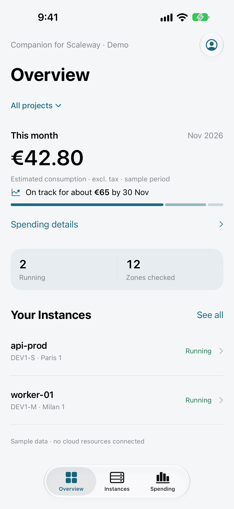
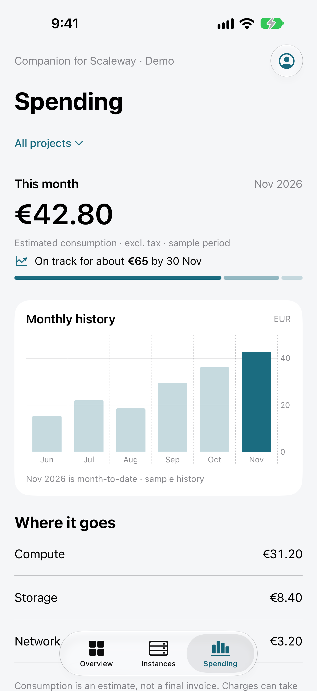
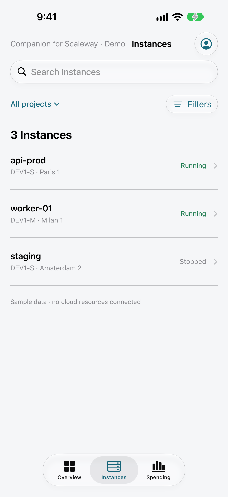
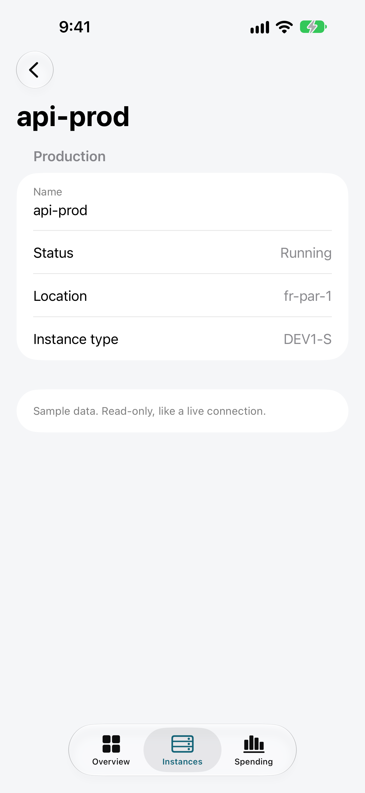
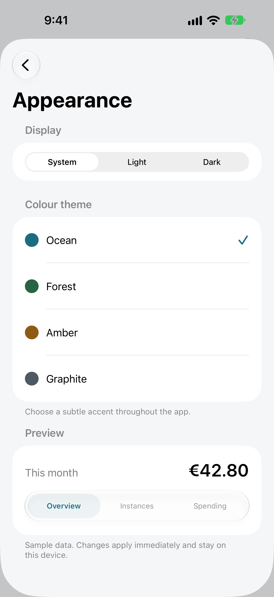
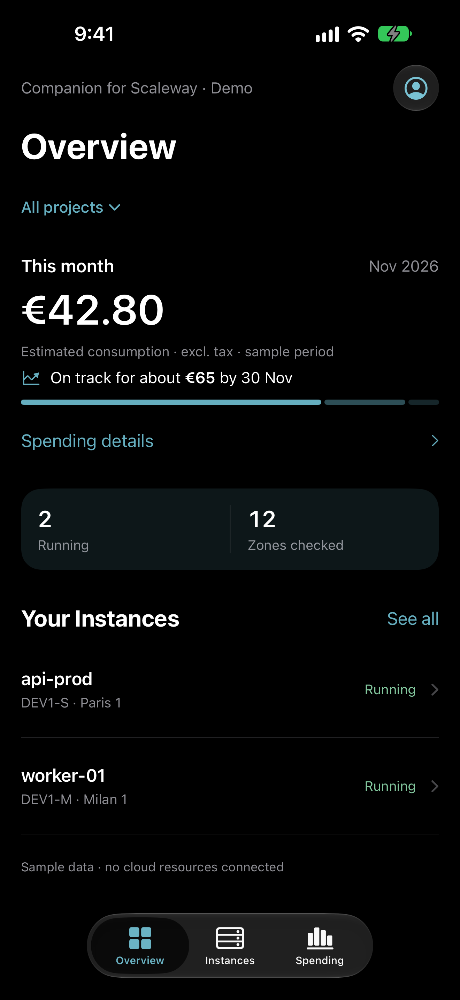

# Companion for Scaleway

[](https://github.com/MoatCast/scaleway-companion/actions/workflows/core-tests.yml)
[](LICENSE)

**Free and open source. No ads, no subscriptions, no tracking.**

See your Scaleway spending, invoices and Instances at a glance on your iPhone. The app is read-only: it never starts, stops, creates or deletes your cloud resources.

<!-- APP STORE LINK: replace this block once the app is live -->
**[Download on the App Store](#)** · coming soon
<!-- /APP STORE LINK -->

[Website](https://moatcast.github.io/scaleway-companion/) · [Privacy](https://moatcast.github.io/scaleway-companion/privacy/) · [Support](https://moatcast.github.io/scaleway-companion/support/)

<p>
  
  
  
</p>
<p>
  
  
  
</p>

## What it does

- **Overview:** this month's spending, an end-of-month forecast and your running Instances.
- **Spending:** six months of history, a breakdown by category and the top resources.
- **Invoices:** issued invoices with tax and discounts; share the PDF.
- **Instances:** every zone, with search and project, zone and status filters.
- **Budget alerts:** a monthly budget with notifications at 80% and 100% (best effort; iOS decides when the app checks).
- **Widgets:** Home Screen and Lock Screen widgets with this month's spend and forecast.
- **Appearance:** four colour themes, light and dark mode.
- **Demo mode:** try every screen with sample data, no account needed.

Independent project, not affiliated with or endorsed by Scaleway.

## Connect your account

**Automatic setup.** Choose **Continue with Scaleway**, sign in on Scaleway's website, pick an Organization and projects, then approve. The app creates a dedicated IAM application with a read-only policy (`InstancesReadOnly` on the chosen projects, `BillingReadOnly` on the Organization) and saves only that key. Scaleway does not officially support browser sign-in for third-party apps, so it may change without notice. Details: [automatic setup and recovery](docs/automatic-setup.md).

**Manual setup.** [Create an API key](https://www.scaleway.com/en/docs/iam/credentials/create-api-keys/) for a dedicated IAM application with the same two permissions, then enter the secret key and Organization ID.

**Demo.** Choose **Explore demo** to look around without credentials.

## Privacy and security

- The app collects no data and has no server. It talks only to `api.scaleway.com` (and `account.scaleway.com` during sign-in).
- Your key is stored in the iPhone's Keychain (this device only, never synced) and sent only to Scaleway over HTTPS.
- Widgets read a small snapshot of totals with no key or resource names.
- **Disconnect** removes everything the app stored. To revoke access everywhere, delete the key in Scaleway's IAM console.

Spending figures are Scaleway's consumption estimates: they exclude tax, can lag behind usage and don't deduct discounts. Invoices show final amounts. Full policy: [privacy](docs/privacy.md).

## Build from source

Requires macOS, Xcode with the iOS 26 SDK and, for device testing, an iPhone on iOS 26 or later.

1. Open `ScalewayCompanion.xcodeproj` and select the **ScalewayCompanion** scheme.
2. Set your own signing team. For a fork, change `APP_BUNDLE_ID` in the project build settings; the widget and App Group (`group.$(APP_BUNDLE_ID)`) follow it.

Run the core tests on macOS, no simulator needed:

```sh
swift test --scratch-path .build/unit
```

Compile for iPhone without signing:

```sh
xcodebuild -project ScalewayCompanion.xcodeproj -scheme ScalewayCompanion \
  -destination 'generic/platform=iOS' build CODE_SIGNING_ALLOWED=NO
```

Design notes: [API connection](docs/api-connection-design.md) · [automatic setup](docs/automatic-setup.md) · [browser sign-in](docs/browser-sign-in-experiment.md).

## Contributing

Bug reports, ideas and pull requests are welcome. See [CONTRIBUTING.md](CONTRIBUTING.md). Report security issues privately through the [security policy](SECURITY.md), and never post keys or account data in public issues.

## Licence

[Mozilla Public License 2.0](LICENSE). Third-party names and trademarks belong to their respective holders.
